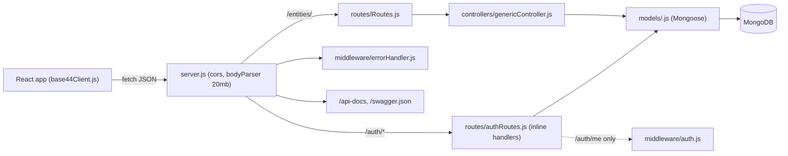

# ARCHITECTURE – reva_designs_server

## Real architecture (VERIFIED)

A flat **route -> generic controller factory -> Mongoose model -> MongoDB** pipeline. There is **no service layer, no repository layer, no DTOs, no request validation layer**; Mongoose schema validation is the only validation. Business rules live in the frontend (see `BUSINESS_DOMAIN.md`).

## Request lifecycle

1. `cors()` (all origins) -> `bodyParser.json/urlencoded` (limit `20mb`, accommodates base64 images).
2. Route match in `server.js`: `/health`, `/auth`, `/entities/<Entity>` (16 mounts), else 404 JSON `{success:false,message:'Route not found'}`.
3. Handler produced by `genericController` (try/catch -> `next(err)`) or inline in `authRoutes.js` (own try/catch, returns 500 itself).
4. `errorHandler` maps `CastError`/`ValidationError`/duplicate-key (11000) to 400, otherwise `err.status || 500`.

## Boundaries & notes

- `server.js` calls `connectDB()` without awaiting; `app.listen` starts regardless; a failed connect exits the process.
- Swagger scans `./routes/*.js` relative to the process CWD, so start the server from the project root.
- Authentication exists only as `/auth/*` login/register plus `middleware/auth.js`; **`/entities/*` routes have no auth or role middleware** (see Known gaps in `BACKEND.md`).
- Collection names are set explicitly per model; `User` -> `Users`, all others singular PascalCase (e.g. `Product`, `OrderItem`).
- Relationships between entities are plain `String` id fields (`product_id`, `order_id`), not Mongoose refs; no `populate`, no transactions.

## Frontend/backend boundary

Frontend never imports server code. Contract = HTTP paths, snake_case fields, and the two response shapes in `API_AND_DATA_FLOW.md`. Cross-project doc: `../reva_designs_frontend-main/.github/context/`.
